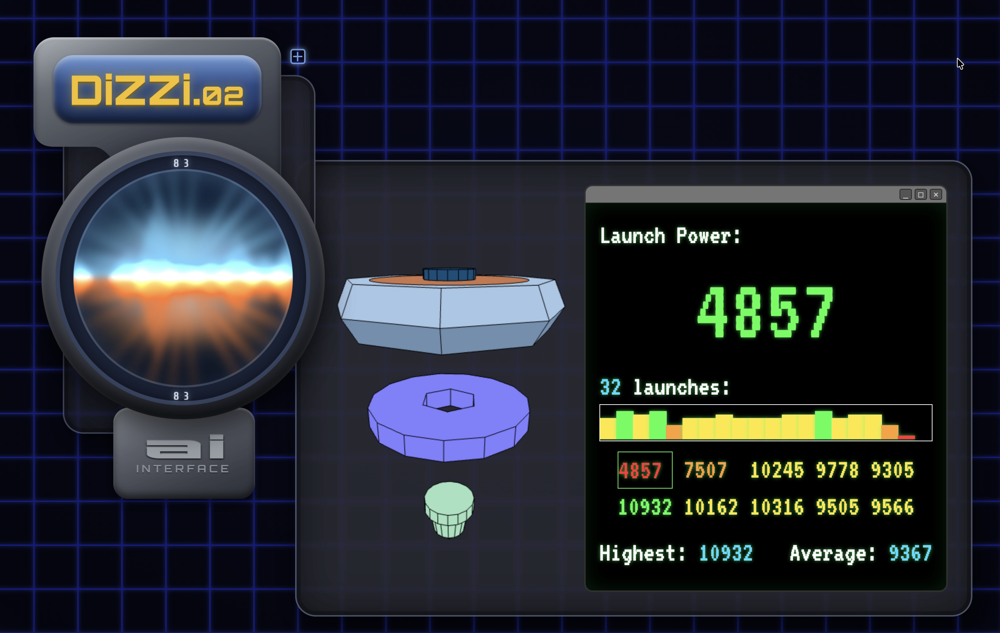
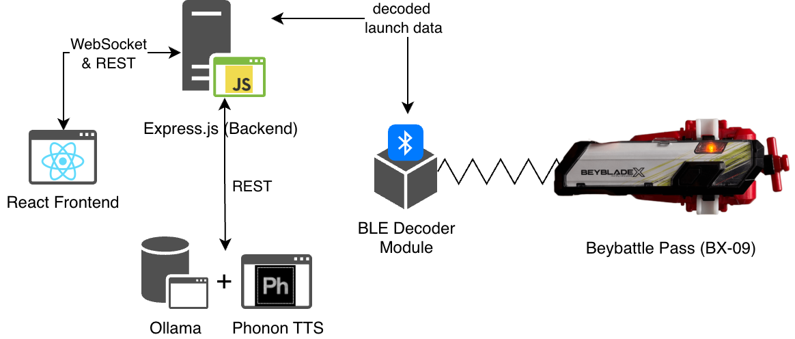

# DiZZi 0.2 [](https://blog.simone.computer/reverse-beyblade-launch-tracker)

[DiZZi](https://beyblade.fandom.com/wiki/Dizzi) is Kenny's AI companion from the 2001 Beyblade anime, brought back as a web app.
It connects to a [Beybattle Pass BX-09](https://beyblade.fandom.com/wiki/Beybattle_Pass), shows your Shoot Power data, and roasts your launches.

## Screenshot



## Requirements

- Node 24 (version pinned in `.nvmrc`) and [nvm](https://github.com/nvm-sh/nvm)
- A Beybattle Pass BX-09
- A computer with Bluetooth (uses [`@abandonware/noble`](https://github.com/abandonware/noble) to talk to the Pass)
- [Ollama](https://ollama.com/download), only needed if you enable the AI features

## Setup and Installation

### 1. Clone the repository

```sh
git clone https://github.com/syxanash/dizzi.git
cd dizzi
```

### 2. Install Node dependencies

```sh
nvm use && npm i
```

### 3. Set up Ollama (optional)

Skip this step if you leave `AI_ENABLED=false`.

After [installing Ollama](https://ollama.com/download), pull the language model:

```sh
ollama pull gemma3:1b
```

## Configure

Create a `.env` file in the project root (`.env.local` is also loaded, for local overrides):

```
AI_ENABLED=true
BACKEND_PORT=4567
```

| Variable       | Default | Description                                                                 |
|----------------|---------|-----------------------------------------------------------------------------|
| `AI_ENABLED`   | `false` | Enables the AI features: Kokoro text-to-speech and Gemma 3 launch comments |
| `BACKEND_PORT` | `4567`  | Port of the backend server; the frontend proxies `/api` and `/ws` to it    |

## Usage

To start DiZZi, run this from the root of the project:

```sh
npm run prod-start
```

Then open [http://localhost:4173](http://localhost:4173).

For development, with hot reload, run:

```sh
npm run dev-start
```

Then open [http://localhost:5173](http://localhost:5173).

## Architecture



The Node backend reads launch data from the Beybattle Pass over Bluetooth LE and streams it to the React frontend over a WebSocket. When AI is enabled, the backend asks Gemma 3 (via Ollama) to comment on each launch, and Kokoro reads the comment out loud.

## Troubleshooting

- **The Battlepass isn't found:** make sure Bluetooth is on, the Battlepass is awake and nearby, and (on macOS) your terminal has Bluetooth permission.
- **No AI comments:** check that `AI_ENABLED=true` is set, that Ollama is running, and that `gemma3:1b` has been pulled.
- **Frontend can't reach the backend:** make sure `BACKEND_PORT` is the same for both, and that nothing else is using that port.

## External resources

* Text-to-speech model: [Kokoro.js](https://huggingface.co/posts/Xenova/503648859052804)
* LLM: [Gemma 3:1b](https://ollama.com/library/gemma3), pulled from Ollama
